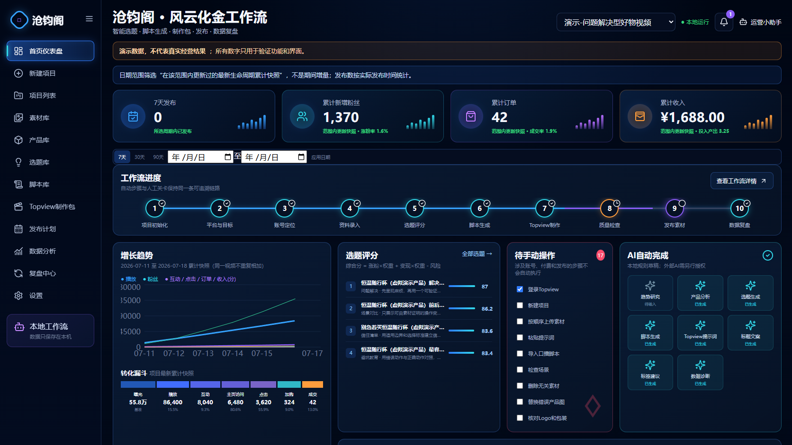

# 沧钧阁 · 风云化金工作流

[](https://github.com/smclw/cangjunge-fengyun-workflow/actions/workflows/ci.yml)
[](LICENSE)

> A traceable, Windows-first local workflow for turning product evidence into topics, scripts, Topview production packages, publishing records, metrics and review experiments.

这是一个只在本机运行的中文操作台，把“资料—选题—三类脚本—Topview 制作包—人工制作/发布—数据—复盘”保存为可追溯项目。第一阶段不会登录 Topview、调用收费接口或自动发布。



## 第一次使用

1. 确认电脑已安装 Node.js 22 LTS。
2. 双击根目录的 `启动工作流.bat`。首次运行会通过 `npm.cmd` 安装依赖并构建页面。
3. 浏览器会打开本机地址。默认从 `http://127.0.0.1:4173` 开始；端口被占用时会自动顺延。
4. 先打开“演示-问题解决型好物视频”熟悉完整数据，再进入“新建项目”。
5. 每次做完一个步骤都点保存。项目事实源位于 `data/projects/<项目ID>/project.json`，不是浏览器缓存。
6. 使用结束可直接关闭浏览器；若要关闭服务，双击 `停止工作流.bat`。

## 日常工作闭环

在新建项目向导中填写平台、目标、定位、产品和研究 Brief；到素材库上传有权使用的原始文件；系统会为每个产品生成 4 个选题，并为最高优先级选题生成涨粉/成交/信任三版脚本与 Topview 制作包。随后由你按可持久化的 16 步清单手动进入 Topview 生成预览、完成质量检查和平台发布，再回到发布计划建立选题/产品/A-B 映射并录入累计快照，最后按视频、平台或项目范围生成复盘和下一轮单变量实验。

## 三个双击入口

- `启动工作流.bat`：检测 Node、按需安装/构建、自动选端口、避免重复启动、写日志并打开浏览器。
- `停止工作流.bat`：仅在项目根目录、进程启动时间、命令行和健康响应身份全部匹配时停止 `.runtime/server.json` 记录的进程。
- `备份项目数据.bat`：备份配置、项目、输出、指标、复盘和日志索引；大型视频只记入排除清单。

运行地址、PID 和端口写入 `.runtime/server.json`；日志在 `data/logs/`。程序只监听 `127.0.0.1`。

## 数据与安全

- 所有项目写入均经过 Zod Schema、临时文件校验、原子替换和 `.bak` 历史备份。
- 项目 ID、存储名、导出与恢复路径经过白名单和目录边界校验。
- 原始素材使用唯一存储名，不覆盖已有文件；授权未知的内容不等于可商用。
- `null` 表示未知，`0` 表示已经测得为零。2h/24h/72h/7d/30d 是发布以来累计快照，同一视频聚合时只取最新节点。
- 金额以分为最小单位保存，界面再显示为元；演示项目始终显示“演示数据，不代表真实经营结果”。
- 不要在项目中保存密码、Cookie、Token 或私钥。

## 导出与恢复

项目列表的下载按钮会生成 00—19 共 20 个标准文件及 `project.json` 的 ZIP。设置页可创建系统备份；恢复前必须人工确认，系统先为当前状态另建备份，再校验 ZIP 路径、manifest 哈希、项目/配置 Schema 和交叉引用，普通素材与输出一并恢复，大型原始视频按 manifest 排除说明处理。

## 开发与验证

```powershell
npm.cmd run typecheck
npm.cmd run test:unit
npm.cmd run test:integration
npm.cmd run test:e2e
npm.cmd run validate
powershell.exe -ExecutionPolicy Bypass -File scripts\validate.ps1
```

## 参与完善

欢迎提交 Bug、功能建议、文档和 Pull Request。开始前请阅读 [贡献指南](CONTRIBUTING.md)、[路线图](ROADMAP.md)、[行为准则](CODE_OF_CONDUCT.md) 和 [安全政策](SECURITY.md)。适合第一次贡献的任务会使用 `good first issue` 标签。

## 开源许可与声明

项目使用 [Apache License 2.0](LICENSE)。Topview 名称及商标归相应权利人所有；本项目不是 Topview 官方产品，也未获得其官方背书。演示数据不代表真实经营结果。

更多说明见 [docs/使用说明.md](docs/使用说明.md)、[docs/Topview手动操作说明.md](docs/Topview手动操作说明.md) 和 [docs/故障排查.md](docs/故障排查.md)。
